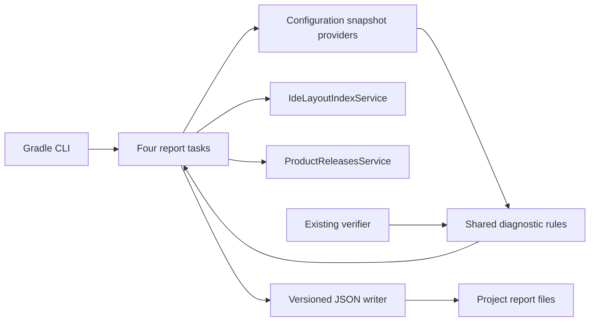

# Requirements

### Recommendation
Yes. The highest-value improvement is to expose facts the plugin already knows as **documented, versioned JSON reports**, rather than asking agents to reconstruct Gradle configuration or parse console warnings. These capabilities should also be useful to humans and CI, without an MCP server or agent-specific integration.

The investigation found a strong foundation:
- `PrintBundledPluginsTask`, `PrintBundledModulesTask`, and `PrintProductsReleasesTask` already expose discovery information as text.
- `DumpBundledPluginsTask` and related tasks write DevKit-oriented files, not a general structured reporting contract.
- `VerifyPluginProjectConfigurationTask` already supplies detailed findings and suggested fixes through Gradle's Problems API, but its checks share one problem ID.
- `IdeLayoutIndexService` already provides cached plugin/module metadata and classpath ownership; `ProductReleasesService` already supplies release filtering and offline caching.

### Four focused workflows
| New task                   | What an agent gets                                                                                                                                                                                                                        |
|----------------------------|-------------------------------------------------------------------------------------------------------------------------------------------------------------------------------------------------------------------------------------------|
| `intellijPlatformInfo`     | Project/plugin identity, requested IDE, effective Java/Kotlin settings, declared platform/plugin dependencies, configuration switches, and available relevant commands. Optional `--resolve` adds resolved IDE/dependency information.    |
| `intellijPlatformDoctor`   | Existing configuration checks as structured findings with stable IDs, severity, observed/expected values, affected settings, suggested fixes, and documentation links. Missing prerequisites appear explicitly, not as successful checks. |
| `intellijPlatformDiscover` | Filterable bundled plugins, bundled modules, or IDE releases through `--kind=plugins\|modules\|releases`, including exact IDs and target-version context.                                                                                 |
| `intellijPlatformSdk`      | Selected SDK root, platform and bundled plugin/module JAR locations and ownership, effective project compile classpath, and accurately qualified source availability.                                                                     |

### CLI behavior
- Each task writes JSON beneath the current project's `build/reports/intellij-platform/` directory and prints a short summary with its report path. `--output=<path>` overrides the destination.
- JSON files, not console output, are the machine-readable contract: Gradle and user build scripts can emit unrelated messages.
- Every report identifies its schema version, plugin version, project path, target IDE when known, completeness, and unavailable information.
- Discovery supports bounded results and explicit filters, so agents need not ingest an entire SDK catalog.
- Commands require no interactive input. Reports do not compile, launch an IDE, publish, sign, or edit project sources.
- IDE/dependency downloads and cache writes may be necessary for resolved information; document these costs and respect Gradle's `--offline` behavior. The default info report must not resolve/download an IDE.
- Preserve existing print/dump formats, verification behavior, and DevKit integration.

### Scope limits
No MCP server, build-script parser, automatic fixes, general symbol/extension-point search, Marketplace search, or new SDK index. SDK navigation is a file map, as selected; it does not introduce a source downloader. Sources that cannot be established from the selected SDK are reported as `notResolved` or `unavailable`, never guessed from the download-sources preference.

A Gradle task cannot diagnose syntax errors or plugin-application failures that prevent project configuration. Nor can it guarantee a report after an input-validation failure, process crash, or external build logic failure; these limitations must be explicit.

# Technical Design

### Implementation approach
Introduce a small reporting module shared by four normal Gradle tasks. Reuse existing providers and build services rather than maintaining parallel IDE models or scraping task output. Follow the project's `Registrable` companion-object pattern and lazy provider conventions.

Keep report tasks execution-time and initially untracked, following `DumpBundledPluginsTask`: their environment-dependent observations must not be restored as stale cross-machine build-cache outputs. Use the existing Kotlin serialization dependency and atomic/write-if-changed utilities. Do not change the serialization settings of existing cache models.

Avoid broad aware interfaces where they add unwanted behavior. In particular, `tasks/tasks.kt` wires `PluginAware` to patched XML, `RuntimeAware` to runtime lookup, and initialization to a self-update check. New report registration must avoid unnecessary patching, runtime acquisition, and self-update traffic without changing existing task behavior.

### Report contract
Use a dedicated public JSON contract, independent of the internal `IdeLayoutIndex` cache schema:

```kotlin
@Serializable
internal data class ReportEnvelope<T>(
    val schemaVersion: Int = 1,
    val reportType: String,
    val gradlePluginVersion: String,
    val projectPath: String,
    val status: ReportStatus,
    val data: T?,
    val issues: List<DiagnosticIssue>,
    val unavailable: List<UnavailableObservation>,
)
```

- `status` distinguishes `complete`, `partial`, and `failed`; deliberately unrequested resolution is distinct from failed resolution.
- A diagnostic contains `id`, `severity`, `message`, optional observed/expected values and configuration location, suggested fixes, documentation links, and suppression state. Locations must not fabricate source line numbers.
- Use stable ordering, UTF-8, normalized paths, explicit availability states, and no volatile timestamps. Additive schema changes stay compatible; breaking changes require a new version.
- Write reports atomically. Console messages are informational, not part of the schema. A caught operational failure writes a failed/partial report where possible and fails the task when the requested operation cannot be fulfilled; uncaught failures remain ordinary Gradle failures.
- Doctor findings do not fail the task by default. Its `--fail-on=none|warning|error` option evaluates unsuppressed findings **after writing the report**. This uses ordinary Gradle success/nonzero failure, not custom numeric exit codes.
- Report only an allowlist of relevant build settings and dependency identities. Never dump environment variables, arbitrary Gradle properties, repository credentials, publishing tokens, or signing configuration.

### Workflow implementation
**Project context:** Wire a serializable snapshot from `IntelliJPlatformExtension`, Java/Kotlin task settings, and declared dependency metadata. Use `IntelliJPlatformDependenciesHelper.requestedIntelliJPlatforms` for requested IDE metadata where available; do not force `platformPathProvider()` in the default path. Distinguish Java `options.release`, source/target compatibility, Gradle JVM, and requested toolchain. Expose project-qualified command examples and supported report options for discoverability. `--resolve` may access the resolved platform and relevant dependency configurations, recording provenance and resolution failures explicitly.

**Configuration diagnosis:** Extract the existing rule evaluation into `PluginProjectConfigurationDiagnostics`, accepting a data snapshot and returning findings without logging. Both the existing verification task and the new doctor call this module. Preserve the verifier's wording, ordering, Problems API reporting, and warning-muting semantics; assign per-rule report IDs independently of the existing generic Problems API ID. Doctor includes suppressed findings with a marker and records skipped checks. Read effective XML settings without depending on the patch task, and do not acquire a runtime merely to perform the runtime-vendor check; mark that check unavailable when appropriate.

**Discovery:** Use `IdeLayoutIndexService` for plugins/modules and `ProductReleasesService` with `ProductReleasesFilterParameters` for releases. Add CLI options for query, result limit/offset, and release type/channel/build range. Filter and sort before pagination; return total matches and truncation metadata. Include module aliases and dependency relationships without collapsing entries with duplicate IDs or aliases. Use report-local references rather than promising that internal index keys are stable across SDKs. Explicit release filters must work without resolving an IDE. Do not advertise catalog membership as proof of plugin compatibility.

**SDK file map:** Combine `ProductInfo`, the existing layout index, and resolved compile artifacts. Return the SDK root plus SDK-relative archive paths, plugin/module ownership and dependency references, and separately identified external compile artifacts. Support narrowing by owner ID. Establish source paths only from identifiable files belonging to the selected SDK; otherwise return a qualified availability state. `GradleProperties.DownloadSources` controls IDE integration and is not evidence that sources exist locally. Do not scan the entire Gradle/user cache or create a second archive index.

### Architecture


### File structure
Paths below are relative to `src/main/kotlin/org/jetbrains/intellij/platform/gradle/` unless stated otherwise.

**Add**
- `tasks/IntelliJPlatformInfoTask.kt`, `tasks/IntelliJPlatformDoctorTask.kt`, `tasks/IntelliJPlatformDiscoverTask.kt`, `tasks/IntelliJPlatformSdkTask.kt` — task properties, CLI options, registration, and execution.
- `reporting/ReportModels.kt`, `reporting/ProjectSnapshotProvider.kt` — report contracts with their shared JSON writer, and provider-backed observations.
- `reporting/SdkReportProvider.kt` — shared layout mapping and SDK file-map helpers, without a separate layout-provider file.
- `reporting/PluginProjectConfigurationDiagnostics.kt` — shared diagnostic snapshot and rule evaluation.
- Corresponding task tests under `src/test/kotlin/org/jetbrains/intellij/platform/gradle/tasks/` and focused reporting/rule tests under the matching `reporting/` test package.
- Repository-root `CLI_REPORTS.md` — schemas, command recipes, output locations, costs, failure semantics, and limitations.

**Modify**
- `Constants.kt` and `plugins/project/IntelliJPlatformBasePlugin.kt` — task names and registration, including availability on module projects without assuming a standalone plugin descriptor.
- `tasks/tasks.kt` — narrowly separate report wiring from unnecessary initialization and aware-interface side effects.
- `tasks/VerifyPluginProjectConfigurationTask.kt` and its existing tests — delegate rule evaluation while preserving legacy behavior.
- Repository-root `README.md` and `CHANGELOG.md` — link the CLI guide and announce the additive tasks.

# Testing

### Agent-checkable validation
Use the existing `IntelliJPluginTestBase`/TestKit fixtures and configuration-cache pattern in `PrintBundledPluginsTaskTest`. Validate parsed JSON, not console substring approximations.

- **Context:** Default info works with declared settings and no resolved IDE; `--resolve` reports the actual product/build. Cover Java-only, Kotlin, local SDK, overridden `options.release`, missing platform declaration, and module projects.
- **Diagnostics:** Existing verifier tests remain unchanged in outcome. Check stable per-rule IDs, suggested settings, suppression, skipped runtime/XML observations, and report creation before `--fail-on` failure.
- **Discovery:** Test exact IDs, aliases and collisions, deterministic sorting, empty matches, pagination, release filters, and cached/offline success versus an offline cache miss. Explicit release filters must not download an IDE.
- **SDK:** Verify reported files exist, ownership and relative paths are correct, external classpath artifacts remain distinct, and unavailable sources are not misrepresented as present.
- **Cross-cutting:** Run each task twice with configuration cache; check no compile, patch-XML, sandbox, IDE-launch, signing, or publishing tasks execute. Check default info does not trigger IDE/runtime resolution or self-update requests.
- **Contracts and safety:** Test schema fixtures, custom output paths including spaces, deterministic serialization, atomic writes, and exclusion of seeded secret properties. Retain legacy print/dump output regression coverage.

Document and exercise examples such as:
```bash
./gradlew :plugin:intellijPlatformInfo --console=plain
./gradlew :plugin:intellijPlatformDoctor --fail-on=error --console=plain
./gradlew :plugin:intellijPlatformDiscover --kind=plugins --query=java --limit=20
./gradlew :plugin:intellijPlatformSdk --output=build/sdk-map.json
```
No builds or tests need to be run during planning; these checks belong to implementation.

# Delivery Steps

### ✓ Step 1: Expose project context through a versioned report
`intellijPlatformInfo` produces a documented JSON snapshot without resolving an IDE by default.

- Add the shared report envelope, atomic writer, and provider-backed project snapshot under `reporting/`.
- Register the task through `Constants.kt` and `IntelliJPlatformBasePlugin.kt`; narrowly adjust report wiring in `tasks/tasks.kt` to avoid unnecessary initialization.
- Implement default declared/effective settings, command discoverability, `--output`, and opt-in `--resolve`, with explicit unavailable states and secret allowlisting.
- Add TestKit coverage for Java/Kotlin settings, missing SDK configuration, module projects, no-resolution behavior, and configuration-cache reuse.
- Establish `CLI_REPORTS.md` with the common contract and context-report examples.

### ✓ Step 2: Share configuration rules and add structured diagnosis
`intellijPlatformDoctor` returns actionable findings while the existing verifier retains its behavior.

- Extract snapshot-based rule evaluation from `VerifyPluginProjectConfigurationTask` into `PluginProjectConfigurationDiagnostics`.
- Keep the verifier's existing messages, Problems API reporting, ordering, and muting behavior through its existing task adapter.
- Implement stable finding IDs, observed/expected settings, suggested fixes, suppression markers, skipped-check reporting, and `--fail-on` after report writing.
- Avoid mandatory XML patching and runtime acquisition in the doctor path.
- Extend the existing verifier tests and add doctor/rule tests, including configuration-cache reuse and partial-data behavior; document diagnosis commands.

### ✓ Step 3: Add bounded plugin, module, and release discovery
`intellijPlatformDiscover` returns filtered, paginated catalogs using existing cached metadata.

- Implement plugin/module discovery using `IdeLayoutIndexService`, preserving aliases and exact dependency relationships when IDs collide.
- Implement release discovery through `ProductReleasesService` and its existing type/channel/build-range filters.
- Add `--kind`, `--query`, `--limit`, `--offset`, and release-filter options with deterministic ordering and total/truncation metadata.
- Verify offline cache behavior, explicit release queries without IDE resolution, empty results, and legacy dump/print compatibility.
- Add discovery schemas and executable recipes to `CLI_REPORTS.md`.

### ✓ Step 4: Expose the SDK file map and complete CLI documentation
`intellijPlatformSdk` identifies the selected SDK files and their owners without introducing symbol search or a source downloader.

- Combine `ProductInfo`, layout-index metadata, and resolved compile artifacts into an owner-filterable SDK report.
- Report SDK-relative archive paths, external artifacts, and qualified source availability without inferring downloaded sources from `DownloadSources`.
- Add tests for local/resolved SDKs, file existence, duplicate identities, missing sources, module projects, configuration-cache reuse, and absence of unrelated task execution.
- Complete `CLI_REPORTS.md` with workflow recipes, schemas, download costs, offline behavior, failure limitations, and privacy guidance.
- Link the guide from `README.md` and record the additive CLI features in `CHANGELOG.md`.

### ✓ Step 5: Simplify the reporting implementation
Keep the four workflows and their JSON contracts while reducing unnecessary files and duplicated plumbing.

- Consolidate the small writer and layout helpers into the existing reporting files.
- Simplify repeated project-snapshot materialization and release-loading setup by reusing existing providers and services.
- Preserve the report-aware interface, offline/error handling, privacy boundaries, and existing test coverage.
- Run focused reporting and legacy regression tests, plugin validation, API checks, and whitespace checks.
