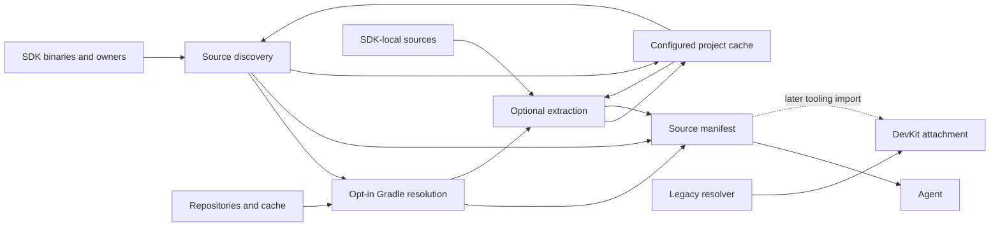

# Recommendation

### Recommended scenario
**Implement headless source discovery and resolution on the current branch, extending its existing agent tasks.** Keep the selected Gradle-plugin-first ownership model: agents consume a versioned manifest now; DevKit can adopt it later. There is no PR merge prerequisite and no need to recreate the reporting infrastructure.

Sources should be a separate capability, not a side effect of ordinary compilation or SDK inspection:

```bash

# Identify required sources without downloading source artifacts

./gradlew intellijPlatformSources

# Download available sources and expose searchable files

./gradlew intellijPlatformSources --download --extract

# Limit work to a bundled plugin/module

./gradlew intellijPlatformSources --owner=com.intellij.java --download --extract
```

The task writes `build/reports/intellij-platform/sources.json`. Agents receive binary-to-source relationships, archive paths, optional extracted directories, and explicit reasons for missing sources. They do not need an IDE, binary decompilation, or their own source-matching heuristics.

### Scope and behavior
- Cover the selected IntelliJ Platform, declared bundled plugin/module dependencies, and third-party libraries identified inside their JARs by `META-INF/maven/**/pom.properties`.
- Prefer source archives already supplied with the SDK. Source-artifact resolution is opt-in with `--download`; discovery may acquire the selected SDK and its binary dependencies, just like `intellijPlatformSdk`.
- `--extract` alone expands SDK-local source archives. Use `--download --offline --extract` to materialize sources from Gradle's artifact cache without network access; never scan private Gradle cache directories.
- Support multiple source archives per binary and one source archive shared by multiple owners.
- Respect configured Gradle repositories, credentials, repository restrictions, caches, and `--offline`.
- Reuse the existing configurable `.intellijPlatform` project cache for source-inspection metadata and extracted source trees, so `clean` does not discard them. Keep downloaded archives in Gradle's artifact cache and reports under `build/reports/intellij-platform/`.
- Return partial results when sources are unpublished, metadata is missing, or a repository is unavailable. Never imply that a downloaded platform archive covers every proprietary or bundled class.
- Preserve the existing SDK report and normal build behavior. General source recovery for arbitrary file dependencies, unpublished Marketplace plugins, and decompilation are outside this increment.

### Additional UI-test regression
Fix `TestIdeUiTaskTest.UI test defaults are registered and isolated` without reverting the branch's intentional `testUi` naming. The default task/source set and source directories must agree with `Constants.Tasks.TEST_UI`; retain the `TestIdeUiTask` type and `intellijPlatformTesting.testIdeUi` DSL. Keep UI tests isolated from ordinary tests and lifecycle tasks.

Deliver this correction in a **separate commit** containing only the UI regression tests, associated task documentation, and the approved lazy source-set registration fix, not the headless-source implementation or its shared-file changes.

### DevKit direction
**Eventually yes, DevKit should consume the plugin’s results for supported Gradle-plugin versions—but not depend on its implementation classes or scrape its cache.** Import the versioned manifest through Gradle tooling, keeping source attachment and navigation in DevKit.

Initially retain DevKit’s existing resolver for older plugin versions, non-Gradle projects, unsupported schemas, and unresolved entries. Remove overlapping rules for the supported path only after parity is established; do not remove the universal fallback prematurely.

# Technical Design

### Current branch integration
- `tasks/agent/AgentReportTask.kt` already supplies the version-1 `Report<T>` envelope, `Issue`/`Unavailable` records, project-relative `--output`, and atomic writing. Register the new task with `registerAgentReportTask`; keep it untracked like the SDK task.
- `IntelliJPlatformSdkTask.kt` exposes SDK-relative binaries and sources, but its `sources` field only lists `src.zip`, `sources.zip`, and archives under `lib/src`. Preserve that field and its presentation-only `--owner` semantics.
- The `IdeLayoutIndex.layoutEntries()` extension in `IntelliJPlatformDiscoverTask.kt` and `IdeLayoutIndexService` supply ownership, aliases, and dependency edges. Reuse these inputs directly, not by invoking or parsing another report task.
- `CapabilityCatalog.kt` feeds `intellijPlatformInfo` commands and capabilities without realizing resolving properties. Advertise source discovery as a resolution-cost workflow because acquiring SDK binaries may be necessary; never evaluate the resolver during catalog enumeration.
- `IntelliJPlatformDependencyGraphTask.kt` demonstrates opt-in resolution and serialized task inputs. Follow that configuration-time/provider boundary: task execution must not access `Project`, repositories, or create configurations.
- `IntelliJPlatformBasePlugin.kt` forwards `GradleProperties.DownloadSources` to the IDEA plugin only; the new task uses its own explicit flags and leaves that preference unchanged. `CLI_REPORTS.md` is the canonical report-contract documentation.
- `GradleProperties.kt` already defines `ProviderFactory.intellijPlatformCachePath(rootProjectDirectory)`, honoring `org.jetbrains.intellij.platform.intellijPlatformCache`. Follow `intellijPlatformProductReleasesCachePath` and the SDK task's root-project provider wiring to add a source-cache subdirectory; do not hard-code a working-directory-relative path or tie source caching to `IntellijPlatformIdesCacheEnabled`.

### Discovery and matching
Keep the IDE-independent rules behind `IntelliJPlatformSourceResolver.discover(input: SourceDiscoveryInput): SourcePlan`. The serializable plan describes source requests and evidence, not repository services or IDE attachment objects.

1. Inventory the selected platform's main SDK classpath and declared bundled dependencies, excluding ordinary project/external dependencies from this increment. Retain all applicable owner references for shared binaries. A supplied `--owner=<exact-id-or-alias>` selects matching layout archives before Maven inspection and source resolution; it does not avoid SDK acquisition or initial layout indexing. An unknown owner yields an empty selection, not a full-SDK fallback.
2. Discover SDK-local source archives using the existing known-location policy. Record them as local candidates without claiming that they cover every binary or satisfy embedded third-party source requests.
3. Generate platform source candidates from the resolved product, version, and build. Port the supported version-dependent rules from the previously inspected DevKit `IntelliJPlatformAuxiliaryArtifactProvider.java` and `IntelliJPlatformSourceCoordinates.java`: IDEA IC/IU/unified transitions, PyCharm variants, and exceptions such as RustRover using IDEA sources. Do not reuse `IntelliJPlatformType.maven` as a universal source mapping; it describes binary artifacts.
4. Read all `META-INF/maven/**/pom.properties` entries directly with ZIP access, without extracting binary JARs. Bound entry counts and metadata bytes; validate coordinates and reject incomplete properties, unresolved placeholders, or dynamic third-party versions. Retain the binary and metadata-entry provenance; deduplicate requests by the full coordinate/classifier.
5. Keep exact third-party versions. For platform sources, try the supported DevKit candidate order, recording any compatible-version or snapshot fallback explicitly. Embedded coordinates and platform mappings identify candidates, not verified package/class coverage, especially for shaded libraries and proprietary code.

### Resolution and cache boundaries
- Lazily wire isolated, resolvable, non-transitive source configurations and lenient artifact views from the discovery plan during task registration/provider evaluation. Resolve only with `--download`; configurations must not extend or modify compile/runtime classpaths. Isolate different versions of the same module so Gradle conflict selection cannot silently replace a requested source version.
- Use only configured Gradle repositories, credentials, content restrictions, and artifact caching. Never add repositories implicitly, use embedded POM repositories, implement a separate HTTP downloader, or inspect Gradle's private cache layout. Report missing repository setup with a safe suggested fix.
- Pass serializable discovery data and Gradle-managed artifact/file providers into the task. Gate all source resolution on its option before evaluation. Capability discovery and unrelated metadata tasks must remain resolution-free even when the source task is registered.
- Add `ProviderFactory.intellijPlatformSourcesCachePath(rootProjectDirectory)` as `intellijPlatformCachePath(rootProjectDirectory).map { it.resolve(CACHE_DIRECTORY_SOURCES) }`, with `CACHE_DIRECTORY_SOURCES = "sources"`. Default to the root project's `.intellijPlatform/sources/`, shared by its subprojects; honor the existing cache-root override without adding another public setting. Capture the resolved cache location through configuration-time providers and pass it as a serializable path or directory property to discovery and materialization.
- Persist inspection metadata under `<sources-cache>/metadata/<scanner-schema>/<binary-content-fingerprint>.json` and extracted roots under `<sources-cache>/extracted/<extractor-schema>/<archive-content-fingerprint>/`. Cache only archive-intrinsic Maven metadata, not SDK-relative paths, owner associations, or repository outcomes; recompute those from the current selection. Do not copy downloaded archives out of Gradle's artifact cache or modify SDK-local archives.
- Use a discovery `ValueSource` with content fingerprints and scanner/rule-schema identity so configuration-cache reuse notices changed local SDK JARs or matching rules. Cache lookup must validate schema/content identity, not only SDK path/build. Preserve per-run artifact availability and retry offline misses rather than freezing failed outcomes in persistent metadata or a configuration-cached snapshot.
- Derived cache entries survive ordinary `clean`; deleting the source-cache subtree or encountering invalid metadata causes safe regeneration from current inputs. A previously cached extraction is not proof that an artifact is still resolved or currently associated with an owner. Cache reuse must not bypass `--download`/`--offline`, repository restrictions, or report freshness.

### Manifest and failure contract
Write `reportType: "sources"` to `build/reports/intellij-platform/sources.json` with the existing envelope and deterministic ordering, explicit nulls, and no timestamps. Its data includes:
- `targetIde`, absolute SDK `root`, selected `owner`, inventory fingerprint, and a self-contained owner catalog. Owner refs remain report-local and distinguish duplicate IDs; never assume they can be dereferenced against a separate SDK report.
- Binary records with stable IDs, SDK-relative paths, owner refs, and existence/inspection evidence.
- Source records with stable IDs, binary/owner associations, origin (`local`, `platformMapping`, or `embeddedMaven`), candidate and selected coordinates, and matching provenance (`exactCoordinate`, `compatibleFallback`, or `unverified`). Preserve many-to-many associations and all archives applicable to an owner.
- Availability (`available`, `notRequested`, `missingOffline`, `notFound`, `unsupported`, or `resolutionError`), optional absolute archive/extracted-root paths, extraction outcome, and sanitized diagnostics. Do not call a generic resolver failure proof that sources were never published.

`complete` means the requested observations succeeded, not complete source coverage. Intentionally skipped downloading uses `Unavailable.state: "notRequested"`, without itself failing the report. Unavailable individual artifacts, malformed metadata, or failed individual extractions produce `partial` with usable results retained. Fatal inventory/operation failures write `failed` before throwing a sanitized `GradleException` where the task can catch them; do not promise a report after build-configuration failure. Never serialize raw exception messages, repository URLs, credentials, environment variables, or arbitrary project properties.

### Safe materialization
Implement source-specific JAR/ZIP extraction rather than using `ExtractorService.extract()`: the distribution extractor rejects JARs and normalizes nested installation directories, which would damage source hierarchy. Follow the bounded ZIP-inspection approach in `tasks/agent/DistributionArchive.kt`, without coupling source handling to distribution reports.

Preserve paths, multiple source roots, and license files. Use the persistent extraction location defined above, not `build/`; distinct archives remain separate and identical content is extracted once across subprojects sharing the cache. Validate normalized paths, absolute/drive paths, traversal, duplicates, and platform-specific collisions; never create or follow archive symlinks or pre-existing destination links. Bound entry counts and expanded bytes, extract into a private temporary directory within the cache filesystem, and publish atomically with a completion marker only after successful completion. Coordinate writers per content key across threads and Gradle processes, rechecking completed entries after acquiring the lock; publish metadata atomically too. Invalid archives must not expose incomplete roots or remove valid cached roots.

### UI default-name correction
The reported exception is explained by a concrete naming mismatch: `Constants.Tasks.TEST_UI` is `"testUi"`, and `TestIdeUiTask.register()` already eagerly creates that default source set before registering the lazy task. However, `TestIdeUiTaskTest.kt` requests `"testIdeUi"`. The current `CHANGELOG.md` explicitly announces `testUi`; agent capability tests already derive the default task name from `Tasks.TEST_UI`.

- Preserve the production default `testUi`, its eager source-set creation, and `registerTask()`/`configureEach` lazy task wiring. The user approved a production fix after three custom-task tests exposed Gradle's mutation guard: create/reuse custom source sets during lazy task initialization rather than inside `configureEach`, and retain dependency/classpath conventions in the callback. Verify custom tasks/source sets are not eagerly realized. Do not rename the constant, add a second default task/source set, or rename the `testIdeUi` testing-extension property.
- Update the default task/source-set references in `TestIdeUiTaskTest.kt`, including `testUiImplementation`, `testUiRuntimeOnly`, `testUiCompileClasspath`, `testUiRuntimeClasspath`, `src/testUi/...`, execution/configuration-cache arguments, lifecycle exclusions, and module-plugin absence assertions. Reuse `Tasks.TEST_UI` in fixture generation where appropriate, retaining an explicit assertion of the intended public name.
- Respect existing lazy configuration in fixtures: realize the specific custom UI task before looking up its generated source set, and realize the default UI task before resolving a configuration whose Starter dependencies are installed by its callback. This applies to the `smokeUi`/`directUi` source-set test, host-engine resolution, and host-property fixture setup; do not solve fixture ordering by eagerly realizing tasks in production.
- Correct `TestIdeUiTask.kt` KDoc's default task/source-directory examples to `testUi`/`src/testUi`, while preserving the class name, custom task semantics, Starter exclusions, JUnit engine behavior, and override support.
- Keep this patch independently committable: stage only the UI test, KDoc, and approved lazy source-set registration changes for a dedicated commit, leaving all pending source-resolution files, shared `Constants.kt` changes, API changes, and the planning file out of it.

### File structure
Paths below are relative to `src/main/kotlin/org/jetbrains/intellij/platform/gradle/`:
- Add `models/IntelliJPlatformSources.kt` for discovery inputs, plans, source coordinates, associations, and outcomes.
- Add `resolvers/sources/IntelliJPlatformSourceResolver.kt` for product rules and bounded Maven metadata discovery.
- Add `providers/IntelliJPlatformSourcesValueSource.kt` for fingerprint-aware lazy discovery, not downloading.
- Add `services/SourceArchiveService.kt` for safe cached materialization.
- Add `tasks/agent/IntelliJPlatformSourcesTask.kt` for report data, options, isolated resolution wiring, and writing.
- Modify `plugins/project/IntelliJPlatformBasePlugin.kt` and `Constants.kt` to register the task on both plugin and module projects and define `CACHE_DIRECTORY_SOURCES`; add the internal source-cache path helper in `GradleProperties.kt` using its existing override mechanism.
- Modify `tasks/agent/CapabilityCatalog.kt` to advertise the qualified task and its costs; add a qualified `sourcesTask` hint to `SdkReport` in `IntelliJPlatformSdkTask.kt`, leaving existing fields unchanged.
- Update root `CLI_REPORTS.md` with the task table, workflow, path semantics, costs, failures, cache locations/override/lifecycle, and future DevKit contract.
- Add resolver/archive unit tests in corresponding `src/test/kotlin/...` packages and `tasks/agent/IntelliJPlatformSourcesTaskTest.kt`; extend the existing `IntelliJPlatformSdkTaskTest.kt` and `AgentReportsContractTest.kt` regressions.
- Separately modify `tasks/TestIdeUiTask.kt` KDoc/initialization and `src/test/kotlin/org/jetbrains/intellij/platform/gradle/tasks/TestIdeUiTaskTest.kt` for the UI default-name correction and approved mutation-guard fix; preserve public APIs and lazy task registration.

### Interaction and deferred DevKit adoption


Discovery determines requirements; Gradle resolves archives; optional extraction makes searchable directories; the manifest joins paths with provenance and ownership. DevKit integration remains a separate repository follow-up using schema negotiation and SDK/fingerprint checks, with archive attachment in the IDE and legacy fallback for unsupported or unresolved cases. Do not introduce an IDE dependency or shared cross-repository library in this implementation.

# Validation

### Automated coverage
Use the current branch's `IntelliJPluginTestBase`, `IntelliJPlatformSdkTaskTest`, and `AgentReportsContractTest` conventions. Use synthetic JAR/source fixtures and a local Maven repository for deterministic downloads; do not depend on live public repositories for resolver edge cases.

- Discovery: version-dependent IDEA/PyCharm mappings, RustRover exception, local SDK archives, multiple/malformed Maven properties, exact coordinate validation, missing metadata, and many-to-many associations.
- Scoping: duplicate owner IDs/aliases, shared archives, unknown owners, fewer metadata scans/download requests when filtered, and no ordinary external-dependency recovery.
- Resolution: no source requests without `--download`; missing classifiers and repository setup, two versions of one library, ordered platform fallback, sanitized failure output, cached/uncached offline runs, and retry after an offline miss or repository recovery.
- Materialization: searchable `.java`/`.kt` files, preserved hierarchy/licenses, shared-content deduplication, JAR/ZIP support, path traversal and link defenses, duplicate/case-colliding paths, oversized/corrupt archives, and atomic failure behavior.
- Freshness: change a JAR at the same path/build and a source archive at the same coordinate; verify fingerprints invalidate metadata/extraction and no configuration-cached failure becomes permanent.
- Project cache: verify the root-project `.intellijPlatform/sources/` default, the existing cache-root override (including paths with spaces), cross-subproject reuse, separate SDK identities/associations, and concurrent Gradle writers. Confirm `clean` retains completed metadata/extractions without reinspection/re-extraction for unchanged content, deleted/corrupt/incomplete entries regenerate safely, and task registration or metadata-only commands do not eagerly populate the source cache. Check that downloaded archives are not duplicated into the project cache and current reports are rewritten under `build/` after `clean`.
- Contracts: deterministic JSON across repeated configuration-cache runs, all statuses, project-relative custom output paths with spaces, plugin/module and multi-project qualified commands, self-contained refs, and additive SDK compatibility.
- Integration: metadata-only reports still pass the existing `beforeResolve` guard after source-task registration and advertise its capability without resolving it. Source workflows may initialize/acquire the SDK but must invoke no compilation, sandbox, test, or IDE-launch tasks.
- UI regression: during implementation, run `./gradlew test --tests '*TestIdeUiTaskTest' --console=plain` after correcting the fixtures, plus the existing agent capability/test-matrix regressions and `apiCheck`. Confirm `testUi` source sets/configurations, Starter dependency isolation, custom task source sets and selected IDE classpaths, overrides, host engines/properties, configuration-cache reuse, module exclusion, and absence from the ordinary `build`/`check`/`test` task graph. Preserve the local-IDE/local-repository fixtures; no actual IDE launch is required. The separate commit must contain only the UI test/KDoc patch.

Compile changed Kotlin code with the IDE build check during implementation, run focused tests as each capability is added, and run the existing agent-report regression suite before completion. Planning changes only this plan file; implementation and test execution are requested next.

# Delivery Steps

### ✓ Step 1: Implement source discovery on the existing agent-report framework
`intellijPlatformSources` writes a versioned source plan for the current SDK without resolving source artifacts.

- Add the serializable discovery model, version-aware platform mappings, and bounded embedded-Maven scanner.
- Add fingerprint-aware discovery inputs using `IdeLayoutIndexService` and `layoutEntries()`, with source-task-specific owner scoping and self-contained associations.
- Add the internal source-cache path helper and constant, using the existing root-project cache provider and override; persist bounded archive-intrinsic metadata under content/schema keys with atomic writes and rebuildable invalid entries.
- Register `IntelliJPlatformSourcesTask` through `AgentReportTask`, `Constants.kt`, and `IntelliJPlatformBasePlugin.kt` using existing output/failure conventions.
- Compile the new Kotlin code and test local archives, mapping exceptions, malformed metadata, unknown owners, deterministic reporting, discovery without source downloads, the cache-root override, and metadata reuse/invalidation without stale owner associations.

### ✓ Step 2: Implement opt-in Gradle source resolution with partial results
`--download` resolves exact source requests or documented platform fallbacks without altering compilation dependencies.

- Wire lazy, isolated, non-transitive source configurations and lenient artifact providers from the discovery plan; keep repository access outside task actions.
- Reuse configured repositories and Gradle caches, isolate competing versions, and record selected coordinates and fallback provenance.
- Implement safe per-artifact diagnostics, optional-source partial results, fatal-report-before-failure behavior, and retryable offline misses.
- Compile and test local-repository resolution, absent classifiers, repository failures, independent versions, offline caching/recovery, and configuration-cache reuse with changed SDK inputs.

### ✓ Step 3: Implement safe searchable source materialization
`--extract` exposes fingerprinted source directories while preserving archive hierarchy and valid cached content.

- Add `SourceArchiveService` for source JAR/ZIP extraction, separate from the IDE-distribution extractor, publishing persistent roots under the configured project source cache rather than `build/`.
- Preserve multiple roots and licenses, deduplicate identical content, and attach absolute archive/extracted paths to source records.
- Enforce path/link defenses and resource limits, with private temporary directories, completion markers, per-key cross-process coordination, and atomic publication.
- Compile and test searchable content, SDK-local extraction, offline cached downloads, content invalidation, multi-project/concurrent reuse, survival across `clean`, safe regeneration after cache deletion, and malicious or corrupt archives.

### ✓ Step 4: Integrate source discovery into the agent workflow
Agents discover the qualified source command through project capabilities and SDK reporting, with documented headless usage.

- Add the accurate source-task capability to `CapabilityCatalog.kt` without evaluating its inputs, and the additive `sourcesTask` hint to `SdkReport`.
- Update `CLI_REPORTS.md` with commands, source states, path bases, scoping differences, costs, failures, and schema/SDK checks for later DevKit adoption; document Gradle-managed archives versus persistent `.intellijPlatform` derived data, the existing cache-root override, and cleanup/regeneration behavior.
- Preserve the existing SDK `sources` field and presentation-only owner filtering; leave DevKit implementation and legacy fallback unchanged.
- Extend SDK and metadata-contract tests, run end-to-end plugin/module workflows and the agent-report regression suite, and verify no unrelated build or IDE tasks execute.

### ✓ Step 5: Correct UI-test defaults and deliver an isolated fix commit
`TestIdeUiTaskTest` validates the registered `testUi` defaults, and the UI correction is committed independently of headless-source work.

- Align default task names, source sets/configurations, fixture source paths, execution arguments, and module/lifecycle assertions in `TestIdeUiTaskTest.kt` with `Constants.Tasks.TEST_UI`; keep the `intellijPlatformTesting.testIdeUi` DSL unchanged.
- Correct fixture ordering where lazy custom tasks create source sets or install dependencies: realize only the task under inspection before querying those conventions, without changing production laziness.
- Update the default-name examples in `TestIdeUiTask.kt` KDoc and move custom source-set creation out of `configureEach` into lazy task initialization to avoid Gradle's mutation guard; retain lazy registration, dependency isolation, classpath order, JUnit behavior, and user overrides. Add an assertion that custom source sets do not appear before task realization.
- Compile the affected Kotlin code, run the focused UI suite and existing agent capability/test-matrix regressions, and check API compatibility without launching an IDE.
- Create a separate commit such as `Fix UI test fixtures for testUi defaults`, staging only these UI test/KDoc and approved lazy source-set registration changes. Exclude all headless-source implementation, shared constants/API changes, unrelated pending work, and this plan file.