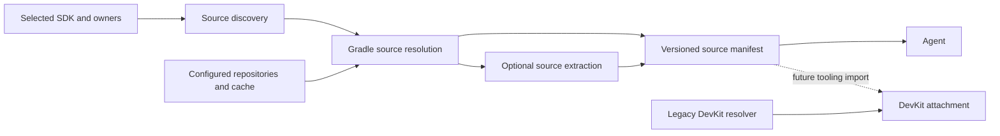

# Recommendation

### Recommended scenario
**Make the Gradle plugin responsible for headless source discovery and resolution. Let agents consume a versioned manifest; let DevKit adopt that manifest later.** This follows your selected ownership model without requiring coordinated releases immediately.

Sources should be a separate capability, not a side effect of ordinary compilation or SDK inspection:

```bash
# Identify required sources without downloading them
./gradlew intellijPlatformSources

# Download available sources and expose searchable files
./gradlew intellijPlatformSources --download --extract

# Limit work to a bundled plugin/module
./gradlew intellijPlatformSources --owner=com.intellij.java --download --extract
```

The task writes `build/reports/intellij-platform/sources.json`. Agents receive binary-to-source relationships, archive paths, optional extracted directories, and explicit reasons for missing sources. They do not need an IDE, binary decompilation, or their own source-matching heuristics.

### Scope and behavior
- Cover the selected IntelliJ Platform, declared bundled plugin/module dependencies, and third-party libraries identified inside their JARs by `META-INF/maven/**/pom.properties`.
- Reuse locally supplied sources where possible. Download only when explicitly requested; extraction is independently optional.
- Support multiple source archives per binary and one source archive shared by multiple owners.
- Respect configured Gradle repositories, credentials, repository restrictions, caches, and `--offline`.
- Return partial results when sources are unpublished, metadata is missing, or a repository is unavailable. Never imply that a downloaded platform archive covers every proprietary or bundled class.
- Preserve the existing SDK report and normal build behavior. General source recovery for arbitrary file dependencies, unpublished Marketplace plugins, and decompilation are outside this increment.

### DevKit direction
**Eventually yes, DevKit should consume the plugin’s results for supported Gradle-plugin versions—but not depend on its implementation classes or scrape its cache.** Import the versioned manifest through Gradle tooling, keeping source attachment and navigation in DevKit.

Initially retain DevKit’s existing resolver for older plugin versions, non-Gradle projects, unsupported schemas, and unresolved entries. Remove overlapping rules for the supported path only after parity is established; do not remove the universal fallback prematurely.

# Technical Design

### Findings and baseline
- [PR #2270](https://github.com/JetBrains/intellij-platform-gradle-plugin/pull/2270) adds `tasks/agent/AgentReportTask.kt` and `IntelliJPlatformSdkTask.kt`. These are **not present in the local checkout**, so this work targets the PR’s agent-report baseline rather than recreating it.
- Its `SdkReport.sources` is a list of archives found in known SDK locations. It does not download sources or associate them with binaries. Its classpath and layout-owner records are useful inputs.
- Local `services/IdeLayoutIndexService.kt` provides cached layout ownership. `IntelliJPlatformBasePlugin.kt` only forwards `GradleProperties.DownloadSources` to `idea.module.downloadSources`; this is not a headless resolver.
- DevKit’s [source-coordinate rules](https://github.com/JetBrains/intellij-community/blob/master/plugins/devkit/intellij.devkit.gradle.tooling/src/com/intellij/devkit/gradle/tooling/IntelliJPlatformSourceCoordinates.java), [auxiliary artifact provider](https://github.com/JetBrains/intellij-community/blob/master/plugins/devkit/intellij.devkit.gradle.tooling/src/com/intellij/devkit/gradle/tooling/IntelliJPlatformAuxiliaryArtifactProvider.java), and [attachment provider](https://github.com/JetBrains/intellij-community/blob/master/plugins/devkit/intellij.devkit.gradle/src/IntelliJPlatformAttachSourcesProvider.kt) are reference implementations. Some resolution already executes in Gradle, but is supplied by the IDE.

### Source-resolution module
Keep product rules and archive inspection behind one internal interface producing a serializable source plan. Task/report code should not contain its own matching rules.

1. Build a binary inventory from the selected SDK and relevant compile dependencies, retaining layout-owner references. `--owner` restricts discovery and downloads, not merely the final JSON display.
2. Prefer explicit/local source associations. Discover platform source coordinates using the actual selected product/build and a version-aware compatibility table. Preserve historical `ideaIC`/`ideaIU`/unified `idea` transitions, PyCharm rules, and product exceptions such as RustRover using IDEA sources; validate mappings per supported release rather than copying a timeless alias table.
3. Read Maven properties directly from binary ZIP directories; do not unpack binary JARs. Collect every valid embedded coordinate, deduplicate requests, and retain provenance. Treat these as source candidates, not proof of complete coverage: shading and relocation can invalidate package correspondence.
4. Resolve exact third-party source versions only. For platform sources, port the supported ordered fallback policy from DevKit and clearly record any compatible-version or snapshot fallback instead of calling it an exact match.

### Gradle resolution and caching
Use separate, non-transitive source-artifact resolution wired through lazy providers during task registration. Keep sources off compile/runtime configurations. Pass serializable values and file/provider inputs into execution; do not access `Project` or create detached configurations from task actions.

Resolve source artifacts leniently through project repositories, with per-request outcomes. Do not discover repositories from embedded POMs or add Maven Central silently. Missing repository configuration should produce an actionable diagnostic.

Reuse Gradle’s artifact cache. Cache metadata inspection by binary content fingerprint and scanner schema; cache extracted sources by archive fingerprint and extraction schema. Changed local SDK JARs must invalidate inspection even when their paths and product build are unchanged. Offline misses remain retryable, not permanent negative results.

### Manifest interface
Reuse PR #2270’s `Report<T>` envelope, atomic writing, `complete`/`partial`/`failed` statuses, and issue records. Define a new `sources` report; do not change the meaning of `SdkReport.sources`.

Each source record contains:
- Stable record ID, associated binary references and layout-owner references.
- Origin: local archive, platform mapping, or embedded Maven metadata.
- Requested candidates and selected coordinate/version, with exact-coordinate, compatible-fallback, or unverified matching provenance.
- Availability: available, not requested, missing offline, not published, unsupported, or resolution error; include a diagnostic where applicable.
- Available archive path and optional extracted root, using explicitly documented path bases.

Record the target SDK identity/build and inventory fingerprint so a future DevKit consumer can reject stale manifests. Distinguish successful artifact resolution from verified source coverage.

### Source materialization
`--extract` expands available source archives; `--download` additionally obtains missing archives. Preserve archive hierarchy and keep archives separate to avoid filename collisions.

Do **not** reuse `ExtractorService.extract()` unchanged: it handles IDE distributions, rejects `.jar` archives as-is, and normalizes nested installation directories. Source extraction must instead preserve package/source-root structure, reject path traversal and unsafe links, bound resource use, and publish completed directories atomically. Preserve license files; do not redistribute source bundles.

### File structure
Paths below are relative to `src/main/kotlin/org/jetbrains/intellij/platform/gradle/`:
- Add `resolvers/sources/IntelliJPlatformSourceResolver.kt`: product mapping and source-plan discovery.
- Add `models/IntelliJPlatformSources.kt`: serializable discovery/report records.
- Add `providers/IntelliJPlatformSourcesValueSource.kt`: lazy discovery inputs for source dependency resolution.
- Add `services/SourceArchiveService.kt`: cached, source-specific extraction.
- Add `tasks/agent/IntelliJPlatformSourcesTask.kt`: discovery/download/extraction options and reporting.
- Extend PR baseline `tasks/agent/IntelliJPlatformSdkTask.kt` with an additive source-task discovery hint.
- Update `plugins/project/IntelliJPlatformBasePlugin.kt` and `Constants.kt` for isolated configurations and task registration.
- Add focused resolver/archive tests and `src/test/kotlin/org/jetbrains/intellij/platform/gradle/tasks/agent/IntelliJPlatformSourcesTaskTest.kt`; extend the PR’s SDK-report tests. Document the workflow and migration contract in `README.md`.

### Interaction and later migration


DevKit adoption is a separate follow-up: negotiate manifest support through tooling, request archive resolution without extraction, attach all applicable archives, and fall back for unsupported or unresolved records. This increment documents that interface but does not modify the IntelliJ repository.

# Validation

### Automated checks
- Use the PR’s `IntelliJPlatformSdkTaskTest` and local `IntelliJPluginTestBase` conventions; use synthetic SDK JARs and a local Maven repository for deterministic source tests.
- Cover platform coordinate transitions, product exceptions, local SDKs, fallback provenance, multiple embedded coordinates, duplicate requests, malformed metadata, and absent sources.
- Confirm discovery makes no source-download requests; downloading changes neither compilation dependencies nor project build files.
- Verify owner filtering reduces inspection/resolution scope and shared source archives are downloaded/extracted once.
- Exercise cached and uncached `--offline` runs, missing classifiers, repository failures, partial results, custom output paths, multi-project task paths, and configuration-cache reuse.
- Check extracted files are searchable, hierarchy is preserved, stale fingerprints invalidate caches, and malicious/corrupt archives cannot publish unsafe or incomplete roots.
- Retain existing SDK-report assertions and verify an end-to-end agent workflow invokes no compilation or IDE-launch tasks.

These are implementation-time checks; no project files were changed or tests run during planning.

# Delivery Steps

###   Step 1: Expose source discovery as a versioned agent report
`intellijPlatformSources` reports source requirements and binary ownership without downloading sources.

- Implement the source-plan model and resolver using the SDK inventory and cached layout-owner records.
- Add version-aware platform mappings and direct inspection of embedded Maven properties.
- Register the discovery task with the PR’s report envelope and `--owner`/`--output` conventions.
- Add deterministic tests for mappings, metadata, many-to-many associations, and owner-scoped discovery.

###   Step 2: Add opt-in headless source artifact resolution
`--download` resolves available source archives through Gradle and reports individual failures.

- Wire lazy, isolated, non-transitive source resolution in `IntelliJPlatformBasePlugin.kt` without changing compilation configurations.
- Reuse configured repositories and Gradle caching; preserve exact and fallback coordinate provenance.
- Add partial-result diagnostics and offline behavior without permanent negative caching.
- Test local-repository downloads, missing artifacts, fallback ordering, cache reuse, and configuration-cache compatibility.

###   Step 3: Materialize searchable source directories safely
`--extract` exposes reusable filesystem roots without unpacking SDK binaries or reshaping source paths.

- Implement source-specific archive handling in `SourceArchiveService.kt`.
- Preserve hierarchy, isolate archives, deduplicate shared sources, and use fingerprinted atomic extraction.
- Reject unsafe paths and links and handle corrupt archives without exposing incomplete roots.
- Test searchable content, invalidation, repeated execution, and archive safety.

###   Step 4: Connect SDK discovery to the source workflow
Agents can discover the source task from SDK reporting, with a documented future DevKit consumption contract.

- Add an additive source-task hint to the PR’s SDK report while preserving its existing `sources` field.
- Document discovery, downloading, extraction, partial results, and path semantics in `README.md`.
- Document DevKit tooling adoption, stale-manifest checks, schema negotiation, and legacy fallback without implementing the cross-repository migration.
- Extend SDK-report regressions and end-to-end source-task tests to verify no compilation or IDE launch is required.